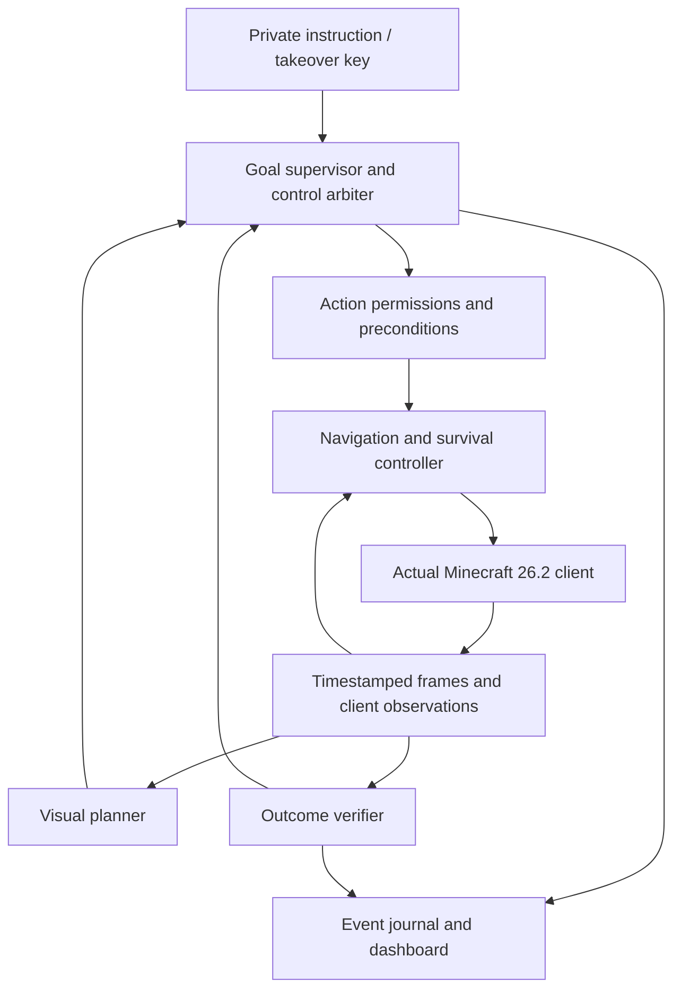

# Minecraft agent redesign

## Gathering policy correction — 2026-09-09

Build `shallow-gather-return-2` supersedes the escape-reserve policy below. The depth-dependent cobblestone quota could increase as the miner descended, driving more excavation. It is removed. Requested gathering materials are excluded from scaffold items, so cobblestone gathered for crafting is not spent returning. Other configured scaffold materials remain available. Direct downward digging is disabled and placement receives a higher path cost. Logs, dirt and cobblestone target searches are limited to three blocks below the starting elevation through Baritone's mining Y settings; this bounds target choice, not every intermediate path position. Dedicated deep-ore expeditions still need a separate access-route policy.

Return goals accept any currently clear, supported, dry standing position within four blocks horizontally and one vertically of the start. They do not require restoring the exact block the player originally stood on. Material count is checked after return; shortfalls produce a failure instead of automatically starting another excavation cycle. No shallow target or usable return route can still fail the job explicitly.

The console now recognizes `get`, `fetch`, `gather` and `collect`, plus `logs`/`log`, `cobble`, and `cancel`. Generic logs choose an already-held supported species, otherwise oak; this is not yet world-aware selection among tree species.

Next pathfinding increment: rank harvesting sites by estimated approach, excavation, pickup and exit cost; plan ingress/egress before committing; remember failed sites; record path stalls and replan from changed terrain. These are not implemented by the settings correction. Validate the current build in leaf-obstructed trees, dirt-covered shallow stone and uneven return areas before calling it reliable.

## Mining access and return — 2026-09-09

Build `mining-access-return-1` replaces direct target breaking with Baritone's mining process. Skill paths may clear intervening leaves, grass, dirt and other blocks; automatic tool selection and inventory transfers are enabled. Each gather records its starting position and returns there before reporting success. Paths can excavate and pillar using dirt, cobblestone, cobbled deepslate or netherrack. Cobblestone gathering requests an extra vertical-depth allowance for escape blocks and rechecks retained material after returning. Failed return paths are reported explicitly. This is a resource allowance, not proof that every terrain configuration has a route.

Skill exit cancels the mining/path processes and restores the previous navigation settings, including on takeover and failure. Nearby tables/furnaces are observed within 24 horizontal and 12 vertical blocks and supplied to each replan; restarting a goal can reuse existing stations. Placement searches a volume around the player rather than four fixed ground positions. Station observations cache for up to one second and invalidate when a skill ends.

Validation: 83 Node tests pass, including reuse of an observed crafting table; the mod compiles and installs. Live obstacle clearing, hotbar recovery and underground return require testing after Minecraft reloads this build. Baritone's target discovery and path search replace the old 12-block gather limit; ore search is still bounded by the action deadline and available world data.

## Skill execution MVP — 2026-09-09

Implemented a client-tick `Skills` controller and serial `SkillExecutor`. Conversational obtain/craft/create requests now execute; `plan <item>` remains a read-only preview. The executor refreshes inventory and expands the remaining goal after every skill, preserves deployed-station knowledge within the run, checks session/epoch ownership, and stops on a failed leaf rather than repeating it. No model is required. Plural `sticks` and generic `planks` are resolved (planks prefer a wood type already in inventory).

Skills: local block discovery, Baritone approach, reach/raycast-checked breaking, harvest-tool checks and inventory-gain completion; nearby station placement/reuse; inventory/table recipe grids populated via ordinary container inputs; and raw iron/coal furnace batches of up to eight ingots. Crafting grids retain recipe geometry. Skills share the existing action lease, deadlines, stop/F8 and death cancellation. Closing an owned crafting menu uses vanilla cleanup, not item injection. Furnace interruptions leave deposited material in the furnace.

Limitations: this is an unvalidated gameplay MVP, not reliable autonomous iron acquisition. Discovery is limited to loaded blocks within 12 horizontal and six vertical blocks, no underground exploration or persistent station map. Paths cannot excavate access tunnels. Block collection may fail when drops cannot be reached; stations beyond the local scan require returning nearer. Furnace input currently requires a single sufficient raw-iron stack, an empty furnace and coal fuel. It does not recover interrupted furnace jobs. Inventory-delta checks use client inventory updates, not an independent server oracle. Skills do not resume after death or takeover. Preview DAGs still report `executable:false` because world preconditions are not established by planning alone.

Validation: 80 Node tests pass; client compilation succeeds. These are not live gameplay acceptance results. Restart Minecraft after installing the new jar before testing. Start with logs to planks, then sticks, then wooden/stone pickaxe before attempting the iron chain. Remaining improvements: live skill fixtures and acknowledgement edge cases; resource exploration and remembered stations; recovery of partially filled containers; persistent goal hierarchy and risk-aware alternative selection.

## Dependency planning — 2026-09-09

Implemented `agent/src/dependencies.js`: bounded symbolic backward chaining over vanilla crafting recipes and a small acquisition-method set (logs, dirt, cobblestone, coal, raw iron, diamond, and raw-iron smelting). Conversational console requests such as `can you create an iron pickaxe?` and `plan 12 dirt` generate read-only plans against fresh inventory. This is a limited intent parser, not general conversational goal understanding. The autonomous `run` loop does not yet execute these plans.

The method library is an AND/OR graph: all ingredients and stations are prerequisites, while recipes and acquisition sources are alternatives. A selected plan is an ordered dependency DAG with quantities, consumed materials, retained tools, shared deployed stations, output batches and leftovers. From empty inventory the iron-pickaxe preview gathers three logs, eleven cobblestone, three raw iron and one coal; it includes a crafting table, wooden and stone pickaxes, and furnace. Ore availability, accessibility and tool durability are unresolved runtime conditions, not proven by a recipe plan.

Research basis:
- [Optimus-1](https://arxiv.org/html/2408.03615v1) uses a hierarchical directed knowledge graph for task dependencies and retrieves/topologically orders task-related subgraphs. Its knowledge-guided decomposition is directly relevant here. This corrects any earlier implication that these systems only ask an LLM for isolated primitive actions. We borrow the planning representation, not its control-loop performance claims.
- [DEPS](https://arxiv.org/abs/2302.01560) combines execution feedback, plan correction and subgoal selection. Adopt explicit failure outcomes and feasibility-based selection rather than repeating impossible leaves.
- [Voyager](https://voyager.minedojo.org/) motivates persistent executable skill reuse and feedback-based improvement. Store verified skills separately from generated task plans.
- [SHOP/SHOP2](https://www.cs.umd.edu/projects/shop/description.html) supplies the older hierarchical task-network foundation: parameterized decomposition methods with preconditions. This is established planning machinery, not a new SOTA claim.

Reuse: cache item-to-method expansion, not an executable plan keyed only by item. Feasibility depends on inventory quantities, shared reservations, tool condition, available stations and world observations. The current implementation uses bounded backtracking with cycle rejection, not globally optimal dynamic programming. Future search can memoize full relevant planning states and rank alternatives by travel, tool cost and risk. A search-limit result is not proof of impossibility.

Execution work remaining, in order:
1. Structured crafting transactions: preserve recipe grid layout in the exporter; select inventory/table menu, place ingredients through ordinary client interactions, await server updates, recover leftovers and verify net output. No inventory injection.
2. `gather(item,count)`: discover loaded candidate blocks, navigate into reach, select a valid tool, aim/break, collect drops, and verify inventory increase. Return typed unreachable/no-source/tool-required/inventory-full outcomes. Structured block state can handle basic mining without a VLM.
3. Station placement/opening and furnace transactions: insert ore/fuel, track actual processing and retrieve output. The preview currently supports coal fuel only and assumes continuous batches; it does not model residual furnace burn time.
4. A serial skill scheduler with cancellation and durable goal state: run ready leaves, reobserve after each, invalidate stale reservations on interruption/death, and replan unmet requirements. DAG nodes are not permission to run simultaneous inventory mutations.
5. General chat intent extraction into typed goals, then persistent project/subgoal hierarchy. The LLM chooses goals and alternatives; deterministic tools own recipe arithmetic and execution verification.

Validation: 73 service tests pass, including resource-ledger replay of the empty-inventory iron-pickaxe plan. This proves neither live mining nor crafting. All previews report `executable: false` until skill executors are connected.

## Skill foundation — inventory and recipes

Implemented read-only `CraftingTools.inventory()`, `craftable()` and `canCraft(item)`, exposed in the console as `inventory`, `craftable` and `can-craft <item>`. Inventory is aggregated by registry ID; crafting previews use the main inventory and hotbar, excluding equipped/offhand items. The static 26.2 catalog is extracted from the installed vanilla game jar. Standard shaped/shapeless recipes are supported; special, cooking and component-bearing output recipes are explicitly outside this first catalog. Server datapacks may differ.

Two-step previews simulate consumption and output quantities, including alternative ingredients. Results are independent possible plans, not a promise that all listed items can be crafted together. A query distinguishes material feasibility from known crafting-station availability. Search is bounded and reports incomplete rather than claiming impossibility. These tools do not execute crafting or create items.

Next skill-execution increment: a cancellable, tick-owned crafting transaction through the ordinary inventory/crafting-table menu, with acknowledgement and inventory-delta verification; then target discovery, aiming, tool selection, breaking and pickup verification for `gather wood`, `gather dirt`, and `gather cobblestone`. Stone must require a suitable pickaxe to count as cobblestone acquisition. Mining success is material gained, not merely a block disappearing. Vision is optional for target selection; inventory and recipe arithmetic remain structured tools.

## Recovery patch status — 2026-09-09

Implemented: normal completion no longer changes control authority; the supervisor consumes action outcomes independently of the displayed reflex phase; queued actions identify themselves and retain their heartbeat while waiting. Stop disarms reflexes. Deliberation does not dispatch task actions while a reflex is active.

Retreat now checks candidate headings for body clearance, a one-block step, nearby support and fluids rather than always pressing forward directly away from a mob. Collision triggers jumping; water triggers upward swimming. Low air interrupts other reflexes to surface. This is local obstacle avoidance, not a complete escape pathfinder: overhangs, enclosed pools, complex walls and multiple threats still require live evaluation and longer-horizon escape planning.

Validation: service regression tests and compilation are separate from gameplay evidence. The new escape behavior must not be called validated until tested against steps, walls and water in the running client. Build identifier: `reflex-recovery-2`.

Status: proposal, not implemented or validated in the Realm.
Date: 2026-09-09.
Target: Minecraft Java 26.2, friends’ Realm, M5 MacBook Air with 24 GB unified memory.

## Decision

Build a client-native agent: a small Fabric integration controls the actual Minecraft client, a dedicated controller executes actions, and a visual planner chooses and revises goals. The user watches the actual game window and can take over immediately. Benchmark a standalone navigation implementation before adding autonomous planning.

This is an engineering proposal informed by research, not a reproduction of a published model. A new prompt or larger model cannot repair an unreliable action interface. Neither a successful unit test nor changing local coordinates proves successful movement on the Realm.

Keep the existing proxy infrastructure available for reference and rollback, but do not make the proposed client-native runtime depend on it. All existing application code is archived under `legacy/`. No legacy module is part of the replacement by default.

## User requirements

- Reach x=200, z=200 in the correct dimension before gathering or construction. Use the Overworld as the initial mission dimension.
- Break and place no blocks during relocation. If reaching the site requires terrain modification, report a blocked route and seek another route.
- After arrival, establish food, tools, a bed and a small shelter; adapt the order to current conditions rather than following a fixed mission list.
- Restrict work to an explicit approved region. The previous radius of 80 blocks is a configuration starting point, not evidence that every block inside it is unowned. Exclude registered structures and containers and stop when ownership is uncertain.
- Use ordinary movement and interaction constraints. Do not enable flight, reach extensions, KillAura, X-ray or player attacks.
- Keep commands, model explanations and diagnostics private. Public chat is untrusted observation, never a control interface.
- Provide natural-language orders, action history, brief decision explanations and visible failure evidence.
- One account is sufficient when the agent operates the user’s client and the user watches or takes over. Playing a separate character alongside it remains a separate-account workflow.

## Research basis

“SOTA” below refers to relevant frontier research and authors’ benchmark results, not a universal ranking. Benchmarks, game versions, task preparation and hardware differ; their scores must not be compared as if measured under identical conditions.

| Work | Evidence and architectural implication | Deployment limit |
| --- | --- | --- |
| [JARVIS-VLA, 2025](https://arxiv.org/html/2503.16365v1) | Trains vision-language models on Minecraft knowledge, visual grounding and action trajectories; generates keyboard/mouse action chunks. Visual understanding alone is not a trained gameplay policy. | Experiments use Minecraft 1.16.5; inference is reported on an RTX 3090. This does not establish Mac or 26.2 Realm support. |
| [OpenHA, 2025](https://arxiv.org/html/2509.13347v1) | Compares action representations and develops Chain of Action. Different tasks benefit from different abstractions; expose both goal-level skills and bounded lower-level actions. | Its trained model and simulator interfaces require adaptation. Our proposed tool interface is inspired by the result, not equivalent to its trained policy. |
| [CrossAgent, December 2025](https://arxiv.org/html/2512.09706v1) | Uses supervised training and reinforcement learning to select among action spaces. Reports 54.6% overall average success on its benchmark, illustrating both progress and remaining unreliability. | Learned action switching cannot be reproduced merely by adding tools to a prompt. Reported task success is not an unattended survival guarantee. |
| [SIMA 2, December 2025](https://arxiv.org/html/2512.04797v1) | Uses recent RGB observations, instructions and keyboard/mouse action chunks; includes dialogue and reasoning capabilities. Supports the real-client observation/action direction. | A research reference, not an assumed available downloadable runtime. No dependence on obtaining its weights or access. |
| [Real-Time Execution of Action Chunking Flow Policies, 2025](https://arxiv.org/html/2506.07339v1) | Explains why asynchronous execution needs continuity between old and new action chunks. Movement must continue while inference runs, with one authority deciding when control changes. | Its inpainting method applies to trained flow policies; our initial deterministic controller does not implement that algorithm. |
| [FutureRTC, July 2026 preprint](https://arxiv.org/html/2607.24008v1) | Predicts execution-time context to address stale observations under inference delay. Track observation age and reject stale commands. | Robotics evidence, not Minecraft validation. Timestamp checks are a practical first step, not a reproduction of its learned prediction modules. |

Implementation sources: [JARVIS-VLA](https://github.com/CraftJarvis/JarvisVLA), [OpenHA/CrossAgent](https://github.com/CraftJarvis/OpenHA). Their published CUDA-oriented setup does not establish Apple Silicon support. Start with available inference adapters and measure; do not promise local throughput based on parameter count.

## Second research round, 2026-09-09

Conducted after gate 1 passed, to check the architecture against current work rather than the papers chosen at the start.

| Work | Finding that changes our design | Deployment limit |
| --- | --- | --- |
| [MineExplorer, 2026](https://arxiv.org/abs/2605.30931) | Evaluates 18 frontier MLLMs on implicit multi-hop Minecraft tasks and reports **navigation failure as the dominant error at roughly 40%**, ahead of gathering, action execution and goal misidentification. Independently validates spending gates 1 and 2 on movement before planning. Its capability taxonomy — perception split into spatial, temporal, entity, state and inventory — exposes that our observation has no temporal dimension. Agents there see up to 20 historical frames; we return one. | Benchmark scores come from a curated task suite, not unattended survival. Larger models and thinking modes did not consistently help, so model choice is not the lever we might assume. |
| [MineEvolve, 2026](https://arxiv.org/html/2603.13131v3) | Improves long-horizon performance without touching model weights, by converting each subgoal execution into **typed** feedback: state change, inventory change, failure type, progress score and a stagnation flag. Repeated failures become stored remedies; successes become skills, admitted only after schema, matchability, executability, specificity and conflict checks. Progress is scored from spatial movement variance, inventory change magnitude and task-specific signals. Reports 34–40% on hard task groups against an Optimus-2 baseline of 32–36%. | The gains are on a planner already capable of the tasks; a memory layer cannot rescue an unreliable action interface. Their thresholds are tuned to their suite. |
| [Optimus-3, 2025](https://arxiv.org/abs/2506.10357) | Task-level mixture-of-experts with an explicit perceive → plan → act → **reflect** loop, using Embodied QA to judge completion. Confirms reflection as a distinct stage rather than a property of the planner. | Completion judged by asking a model. Our outcome evidence — block registry name before and after, measured displacement, inventory delta — is a harder oracle than that for the cases it covers. |
| [Game-TARS, 2025](https://arxiv.org/abs/2510.23691) | A unified **native keyboard-and-mouse** action space, anchored to human inputs, is what makes cross-domain pretraining possible; reports about 2× the previous best success rate on open-world Minecraft tasks. | We deliberately chose semantic actions over a navigation backend, which no pretrained keyboard-policy can consume without an adapter. Our `move`/`look`/`jump` primitives are the beginning of that interface and should be kept honest to real inputs. |
| [AsyncVLA, 2026](https://arxiv.org/html/2602.13476v1) | The fast/slow split with numbers: a base model at 5 Hz off-device and a small onboard adapter at 8 Hz, tolerating up to 6 seconds of guidance latency. Critically, the fast layer receives **both** the current observation and the older observation the slow model actually saw, so it can judge how stale its guidance is and deviate. | Its adapter is trained jointly with the base model. We are not training anything; the transferable idea is the two-observation interface and the frequency split, not the learned adapter. |
| [TypeGo, 2026](https://arxiv.org/pdf/2607.05482) | An explicit **S0 reflex layer** beneath the planner, plus a task scheduler for multi-task arbitration, in a classical three-layer architecture. | Robotics runtime, not Minecraft. Names the structure we are missing rather than supplying it. |

### What this round says we missed

1. **No temporal perception.** `/observe` and `/frame` each return one instant. Every system above consumes a sequence. Our own section 5 already asked for retained frame sequences around failures and it was never built. Cheapest real gap to close.
2. **No failure taxonomy.** Every non-success is `blocked` with free text. MineEvolve's result depends on failures being *typed*, because untyped failure cannot be matched against a remedy later. Our stagnation detection exists for exactly one action (`no observed movement for 15 seconds`) and should generalise into a progress score over movement, inventory and task-specific signals.
3. **No memory.** Nothing survives a session, so a failed approach will be retried indefinitely. Section 3 asked for this explicitly. MineEvolve's Curator checks are a usable specification for when we build it.
4. **The reflex layer is confirmed, not optional.** Two independent 2026 systems put a fast loop beneath the planner. Our control loop is Node polling at 500 ms with no safety tier. AsyncVLA adds a requirement we had not considered: the fast layer should be handed the stale observation the planner saw alongside the current one. Our protocol already carries `observedAt` and `ageMs`, but nothing uses them to modulate behaviour — only to reject.
5. **Action vocabulary is short of the benchmark taxonomy.** MineExplorer's action set is move, jump, collect, place, craft, attack. We have move, jump, break, place. Craft and attack are absent.

## Synthesis: three clocks, one authority

Every system surveyed puts the model inside the control loop. Optimus-3 spends a forward pass on perception, another on planning, another on action, another on reflection, and a fifth on Embodied QA to decide whether the task succeeded. Minecraft ticks at 50 ms; a capable VLM call is 1–10 seconds. The agent is therefore inert and unseeing for 20 to 200 ticks at a stretch, which is what its demo looks like. MineExplorer's headline — navigation is 40% of all errors — is the same disease seen from the evaluation side: those agents walk by asking a model where to put each foot.

They do this because research requires generality. We do not require generality, and refusing it is our entire advantage. Deterministic competence already exists for most of what a Minecraft body does: pathfinding, reach, block identity, inventory arithmetic, collision. Spending model calls there buys nothing and costs the agent its reflexes.

The design rule is therefore: **the model belongs in the goal loop, never in the control loop.** Three clocks, with a single control authority spanning them.

| Clock | Rate | Runs where | Responsibility |
| --- | --- | --- | --- |
| Control | 20 Hz, every client tick | Client mod | Execute the active action, hold safety reflexes, score progress, detect stagnation, validate the assumptions the current decision was made under |
| Verification | Once per action boundary | Client mod | Produce a typed outcome: status, failure class, before/after observations, hard evidence, progress trace. No model call, ever |
| Deliberation | 0.1–0.5 Hz, asynchronous | Agent process | Choose the next goal and repair plans, from a compact digest and typed history. Never holds control |

### What this improves on, specifically

**1. Real-time behaviour comes from determinism, not from a faster model.** Verification is free: we can read block registry names, inventory deltas and positions exactly. Optimus-3 asks a model whether a task completed; we measure it. That removes roughly half the forward passes in their loop before any optimisation, and it makes the remaining ones optional rather than blocking.

**2. Continuity without a trained adapter.** RTC and AsyncVLA solve "keep acting while inference runs" by learning to blend an old action chunk into a new one; AsyncVLA needs a jointly-trained 76M edge adapter to do it. We get the same property structurally, because our actions are semantic and resumable: a `navigate` goal keeps executing at 20 Hz while the model deliberates, and the model's answer either confirms the current goal — costing no interruption at all — or replaces it at a tick boundary. The current supervisor does the opposite: it stops the world before interpreting a replacement. That is correct for a human typing a command and wrong for an agent that must live inside its own inference latency.

**3. Staleness by assumption violation, not by clock.** Timestamp checks, which is all we have today and all FutureRTC's practical layer amounts to, reject decisions that are merely old and accept decisions that are catastrophically wrong but recent. A decision should instead carry the propositions it depended on — "no hostile within 8 blocks", "holding a pickaxe", "health above 12" — and the tick should void it the moment one stops holding, whether that takes 50 ms or a minute. This is only possible because our observations are structured rather than pixels, so it is an advantage of the deployed setting rather than a research contribution we are borrowing.

**4. The model receives a diagnosis, not raw experience.** MineEvolve's result depends on typed feedback, but computes it around the planner. Progress is measurable every tick from real quantities: distance-to-goal delta, displacement variance, inventory delta, block changes. Failure classification follows from those deterministically. The model should be handed `no_progress after 300 ticks, distance to goal unchanged, path recalculated 4 times` rather than twenty frames to interpret.

**5. Known failures cost zero model calls.** Remedies keyed by typed failure plus context can be matched deterministically, so the second occurrence of a failure is repaired without deliberation. Only novel failures reach the model. MineEvolve's Curator checks — schema completeness, context matchability, executability, specificity, conflict — are the admission criteria.

**What we give up, stated plainly.** Anchoring to semantic actions over a navigation backend means no pretrained keyboard-and-mouse policy such as Game-TARS can drive this agent without an adapter, and we cannot benefit from cross-domain pretraining. That is the right trade for an agent that will never be trained, and the `move`/`look`/`jump` primitives must stay honest to real inputs so the option is not permanently closed.

### Implementation order for the synthesis

1. Tick-rate progress scoring and typed failure classes in the mod. Foundational: stagnation, diagnosis and memory all key off it.
2. Observation history, closing the temporal perception gap.
3. Assumption-carrying decisions, validated on the tick.
4. Asynchronous deliberation that never stops the body.
5. Reflex tier under the arbiter, with safety above task.
6. Remedy memory keyed by typed failure.

## Proposed components

### 1. Client bridge

A client-side Fabric mod obtains rendered frames and ordinary client-visible state, and applies inputs/interactions on the game thread. Avoid a server mod requirement so the design can work with a Realm. Use the client’s normal connection and authentication.

Expose health, hunger, inventory, dimension, position, nearby observations and current screen. Restrict observations to the agreed fair-play interface; do not query hidden server data or use buried-ore knowledge for resource discovery. Track client prediction separately from server corrections. In an instrumented test world, server-side position is the authoritative movement oracle; on the Realm, correlate client state, corrections, visual motion and interaction results without inventing per-tick movement acknowledgements.

The first implementation must prove that the displayed POV is the controlled player. Manual takeover cancels queued actions and releases held inputs. Death, disconnect, dimension changes and menus invalidate incompatible actions.

### 2. Fast controller and single control owner

Run action execution on client ticks independently of model inference. Navigation, obstacle response, eating and retreat remain responsive during a slow or failed model call. Begin with avoidance and retreat; add ordinary mob combat only after controlled tests.

Use one control arbiter with priority: manual takeover/stop, immediate safety, then current task. Each action has an ID, session generation, deadline, cancellation token and current owner. A new instruction cancels the old task generation. Late inference results and late action callbacks cannot resume it.

Candidate navigation backend: standalone Baritone, configured to forbid breaking and placement during travel. [Fabric supports 26.2](https://www.fabricmc.net/2026/06/15/262.html). A [26.2 Baritone fork](https://github.com/dysnasia/baritone-26.2/blob/26.2/README.md) exists but explicitly describes itself as work in progress with limited testing. Pin and inspect a candidate revision, then build and test it. Do not assume an unofficial release is production ready. If it fails the navigation gate, reassess the backend before investing in planner integration.

### 3. Visual planner and goal supervisor

The planner receives the current objective, recent frames, structured observations, elapsed time and verified action outcomes. It returns the next subgoal or bounded action, expected outcome, completion conditions and a short user-facing explanation.

Keep goals dynamic: retreat may supersede gathering; missing wool may lead to finding sheep; a blocked route may require a new approach. Replan after meaningful state changes and failures, not by endlessly resubmitting the same command. Retain failed approaches and their evidence to avoid loops.

The supervisor enforces relocation before work. Arrival requires stable proximity to 200,200 in the intended dimension, not a remembered “arrived” flag from an earlier session. The actual interaction target must also pass region checks on every action.

### 4. Multiple action levels

Offer goal-level actions such as navigate, acquire a bounded quantity, craft a known recipe and build a bounded blueprint section. Also offer visible-target interactions and short movement/look commands for recovery. All pass through the same permissions, ownership and cancellation checks.

An action request includes `actionId`, `sessionId`, `observationId`, `deadline`, arguments, expected result and policy scope. An outcome includes status (`succeeded`, `failed`, `cancelled`, `blocked`), before/after observations and evidence. Validate freshness and preconditions again at execution time.

Do not execute arbitrary generated host JavaScript. Dynamic planning can compose actions without shell or filesystem access. A future skill-authoring stage could generate a restricted action program, test it in a disposable world and admit it after validation; it is not required for the initial agent.

### 5. Verification, memory and logging

Measure actual effects: inventory increased, a specific block changed, destination reached, bed placed, or a hostile moved out of range. Do not label dispatch as success or coordinate prediction as confirmed travel.

Persist goals, registered property, known safe locations, recipes/skills and evidence-backed experience. Keep observations distinct from model interpretations and player statements. Log observation age, action owner, phase, cancellation reason, failure classification and model latency.

Use an asynchronous bounded event buffer so logging and dashboard clients cannot block the control loop. Retain short frame sequences around failures and optional local video recording. The private dashboard shows the real-client feed, timeline, current goal, brief rationale and stop/takeover controls. It does not promise access to hidden model reasoning.

## Model and hardware evaluation

Keep the model adapter replaceable. Compare a practical local VLM against a stronger remotely served VLM if remote inference is selected. Remote use requires an explicit decision about provider, cost and sending frames; it is not enabled by this plan. Existing `qwen2.5:14b` is a text model and does not provide the proposed visual perception by itself.

Measure end-to-end p50/p95 inference latency, observation age at execution, memory pressure, sustained game performance and task success on this Mac. A learned Minecraft policy such as OpenHA/CrossAgent is a separate candidate experiment: first establish runnable weights, preprocessing/action compatibility, inference requirements and behavior on the target client. Do not begin with training a foundation policy locally.

## Implementation sequence and acceptance gates

These are proposed acceptance criteria, not achieved results.

1. **Client and control baseline.** Pin Minecraft/Fabric/JDK versions and a navigation candidate. In a disposable singleplayer world, verify forward/turn/jump, inventory interaction and takeover. Stop must release inputs within two client ticks after receipt; cancellation must survive an artificially delayed planner response. No LAN server or second account is needed for a mod operating this singleplayer client.
2. **Navigation without a model.** Run at least 20 recorded routes over flat ground, slopes, forest and water-edge terrain, with breaking/placement disabled. Require at least 19 successes, zero unauthorized block changes, and bounded failure for unreachable goals. Verify motion using the integrated server as well as video. Repeat representative routes with logging enabled and disabled.
3. **Survival without a planner.** Test food use and threat avoidance in controlled scenarios; compare against an idle baseline. Inject inference stalls, dashboard disconnects and repeated orders. No stale action may regain control. Add bounded, normal mob combat only when its evidence improves outcomes.
4. **Adaptive visual planning.** Evaluate changing inventory, missing materials, route obstruction and approaching night. Require outcome-based replanning and no repeated identical failure loop. Record failures as well as successful runs.
5. **Base objective.** From multiple starts, reach 200,200 and pursue food, tools, bed and shelter inside registered work areas. Check protection at action targets, including pathfinding and indirect block changes. Define shelter completion by the actual structure and usable bed, not a checklist flag.
6. **Supervised Realm validation.** Prove client compatibility and motion first, then progressively enable the validated tasks. Compare Realm behavior against the test-world baseline. Do not infer overnight reliability from one successful session.

The critical path is client compatibility → reliable movement → responsive survival → adaptive planning. Stop work on higher layers if a lower acceptance gate fails.

## Repository boundary and proposed layout

Current retained infrastructure: none outside `client-mod/`, `agent/`, `scripts/` and `config/`. The proxy stack was archived on 2026-09-09 once the direct client reached a coordinate on the Realm without it; the client log recorded the route under `baritone/realms/...`, not a proxied server directory.
Current archive: `legacy/realm-bot/`, `legacy/backups/`, `legacy/zenith/`, `legacy/viaproxy/`, `legacy/start-zenith.sh`, old architecture document and agent launchers. Runtime state, dependencies and logs moved with the archived application. Moving files does not stop existing processes.

Proposed new implementation directories, to create when implementation begins:

- `client-mod/`: Fabric bridge, action arbiter, input control and policy enforcement.
- `agent/`: model adapters, goal supervision and memory.
- `dashboard/`: private controls, observations and evidence timeline.
- `evals/`: scenario definitions, recordings and measured reports.
- `config/`: non-secret policy and version manifests.

Do not import legacy gameplay logic implicitly. Reuse any piece only after reviewing its contract and verifying it against the new acceptance gates. Preserve existing infrastructure while the new direct-client design is evaluated.
